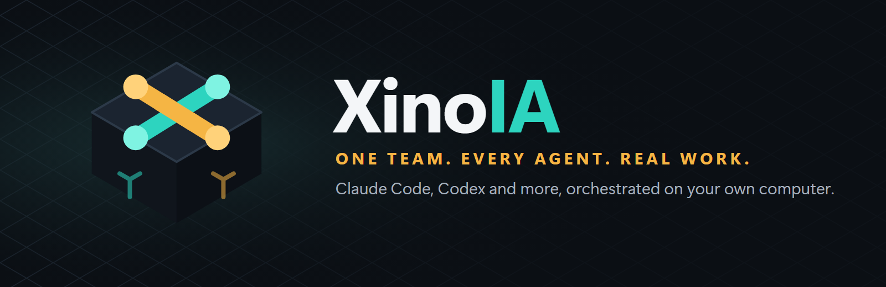
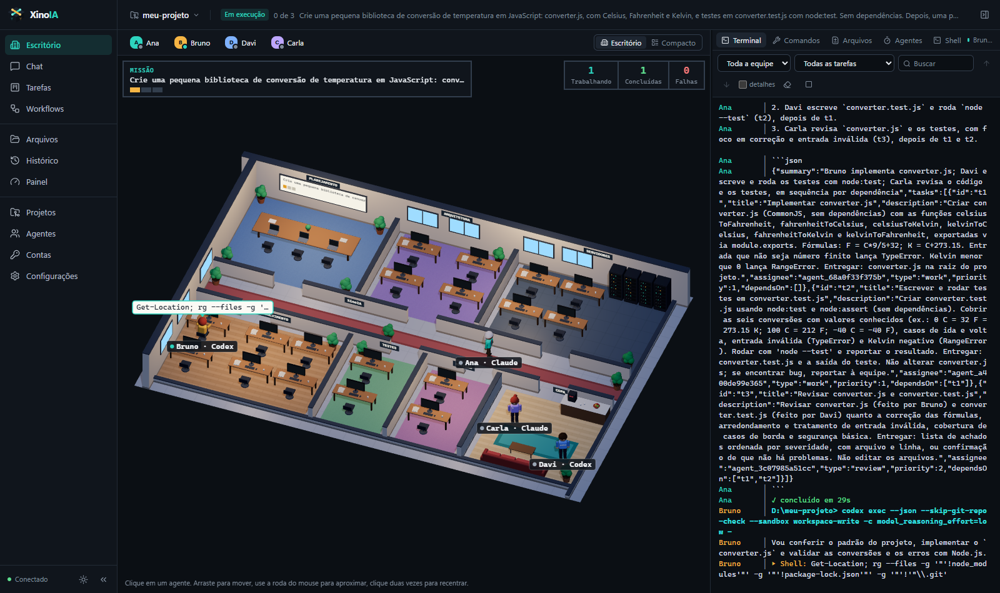
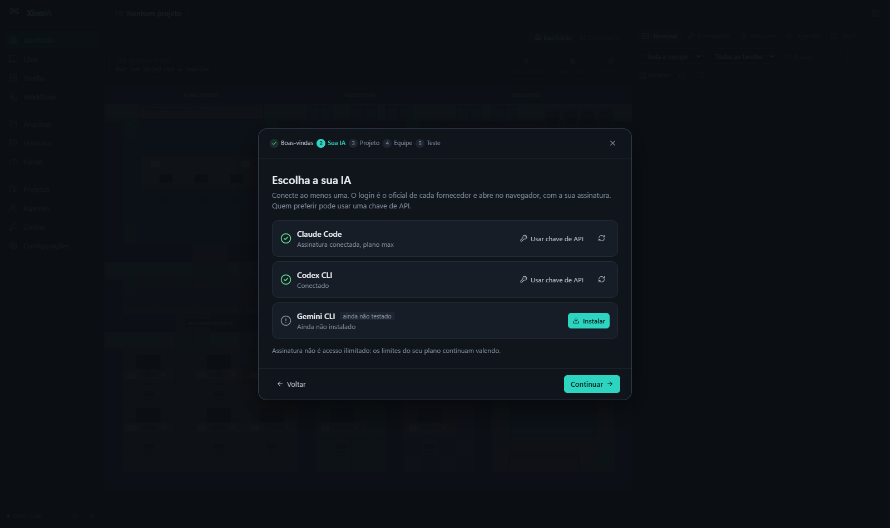
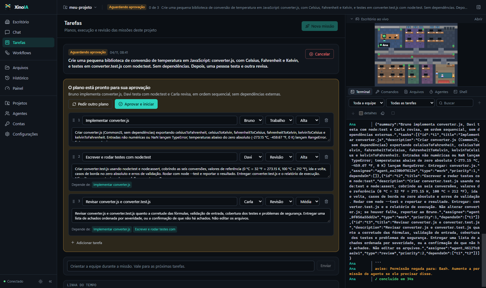
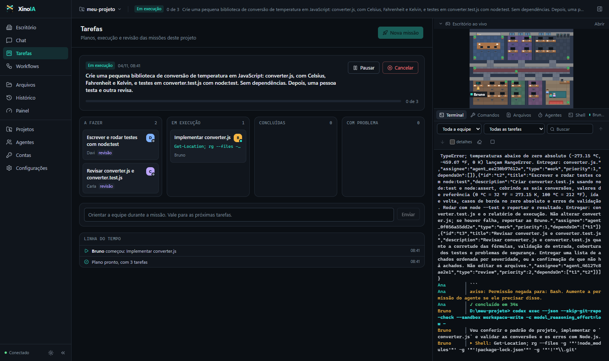
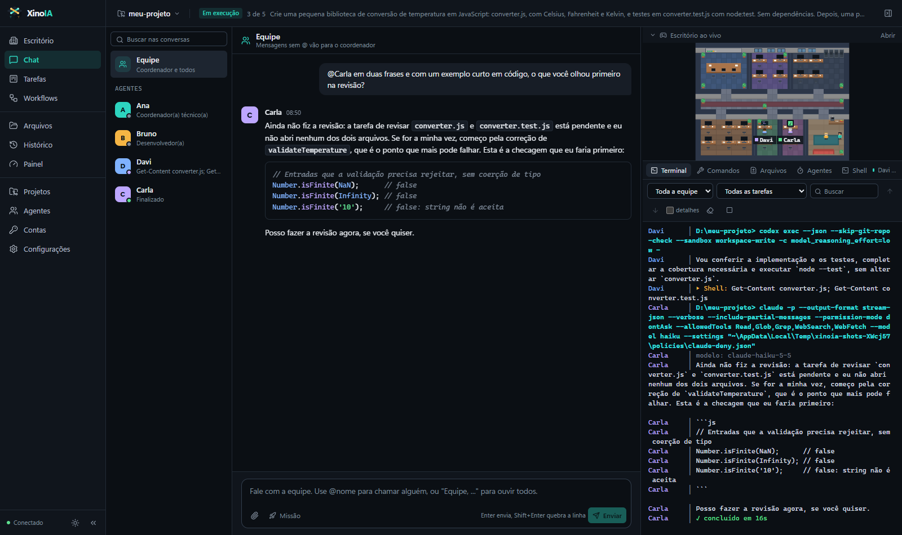
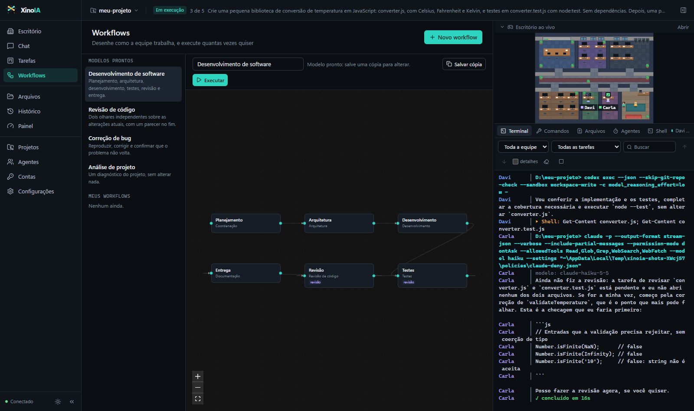

# XinoIA — Your AI team, on your computer, in one office

<p align="center">
  <a href="README.md">English</a> · <a href="README.pt-BR.md">Português (Brasil)</a>
</p>

<p align="center">
  
</p>

<p align="center">
  <a href="https://github.com/HelioASjunior/agents-ia/releases"></a>
</p>

<p align="center">
  <a href="https://github.com/HelioASjunior/agents-ia/actions/workflows/ci.yml"></a>
  <a href="https://github.com/HelioASjunior/agents-ia/releases"></a>
  
  <a href="LICENSE"></a>
</p>

XinoIA runs Claude Code, Codex CLI and other AI coding agents as one team on your own computer. You give the team a goal. A coordinator plans the work, each agent takes a task and hands its results to the next, and another agent reviews them. You follow it all in a live terminal, talk to any agent in chat, and watch the work happen in a game-style virtual office where every animation comes from a real event.

**Your accounts, your machine.** XinoIA runs on your computer and drives the official CLI of each vendor. You choose the AI and sign in through your browser with your subscription, or use an API key if you prefer. It never sees your passwords or login tokens, and an API key stays encrypted by Windows. Projects, conversations and history stay in a local database, and there is no XinoIA server, sign-up or telemetry. It only contacts GitHub to check for updates; your prompts go to the AI tools you choose.

[Download](https://github.com/HelioASjunior/agents-ia/releases) · [User guide](docs/USER_GUIDE.md) · [Provider support](docs/PROVIDERS.md) · [Architecture](docs/ARCHITECTURE.md) · [Security](SECURITY.md) · [Changelog](CHANGELOG.md)

<p align="center">
  
</p>

## Install

### Windows 10 and 11

1. Open [Releases](https://github.com/HelioASjunior/agents-ia/releases) and download `XinoIA-Setup-vX.X.X.exe`.
2. Run the installer.
3. Open **XinoIA** from the Start menu. A short wizard does the rest.

You don't need Node.js or developer tools to run XinoIA itself. Updates arrive inside the app, and your data is kept across updates.

> [!NOTE]
> The installer doesn't have a Microsoft code signing certificate yet, so Windows may show a SmartScreen warning. Choose **More info**, then **Run anyway**. [Why this happens](SECURITY.md#instalador-e-smartscreen). The signing plan is in the [Code signing policy](#code-signing-policy).

Prefer not to install? Download `XinoIA-Portable-vX.X.X.exe`, which keeps its data in a folder next to it.

### Your AI tools

XinoIA doesn't include them, but the wizard helps: choose the AI, install it with one click if you don't have it yet, and connect your account.

- **Sign in through the browser:** opens the vendor's official page, where you sign in as usual, including with Google if your account uses it. The window closes by itself when sign-in finishes.
- **Use an API key:** for pay-as-you-go. The key stays encrypted by Windows, tied to your user.

<p align="center">
  
</p>

The Claude Code installer doesn't need Node.js. The Codex CLI and Gemini CLI installers do need [Node.js](https://nodejs.org).

## What it does

<table>
  <tr>
    <td width="50%"></td>
    <td width="50%"></td>
  </tr>
  <tr>
    <td><b>The coordinator plans, you approve.</b> It examines your project first. You can edit the plan or ask for another one.</td>
    <td><b>Work moves between agents on its own.</b> Each task receives what the others delivered, and a rejection goes back for fixing.</td>
  </tr>
  <tr>
    <td></td>
    <td></td>
  </tr>
  <tr>
    <td><b>Talk to anyone.</b> Mention <code>@name</code>, or start with "Equipe, ..." to hear everyone. Conversations continue where they stopped.</td>
    <td><b>Design your own process.</b> Draw steps and conditions, or start from a ready-made template.</td>
  </tr>
</table>

The interface is in Brazilian Portuguese for now.

- **Game-style office:** each agent is a pixel art character with a desk in the room of its role. When work arrives, the agent leaves the break room for the desk, the monitor lights up and a speech bubble shows what it's doing. A small live view of the office stays visible on every other screen.
- **Live terminal:** the real output of each tool, for the whole team or one agent, searchable and kept across restarts. There's also a real interactive shell.
- **Isolated parallel work:** in a Git project, parallel tasks run in separate worktrees. Your folder only changes after you review and approve. A conflict becomes a task, and nobody's work gets overwritten.
- **Execution modes:** supervised, semi-autonomous and controlled autonomous, with permission limits, deny rules and interruption of destructive commands.
- **Honest numbers:** usage and limits appear only when a tool reports them. Nothing is invented.
- **Unreal Engine:** use the official Epic Games skills and Unreal Editor tools through MCP.

## How it fits together

- **Providers** are adapters around each official CLI, unmodified. Adding a tool doesn't touch the rest.
- **Profiles** keep each account in its own folder, using the isolation the CLI itself offers.
- **Agents** combine a role, a tool, a profile, a permission level and integrations.
- **Missions** turn a goal into tasks with dependencies, reviews and a final report.
- **The office** shows those events and decides nothing: available agents stay in the break room, working agents stay at their desks, and whoever delivers a task carries the document to a colleague.
- **SQLite** stores everything locally, in WAL mode, with versioned migrations and automatic backups. You don't install a database server.

## Supported tools

| Tool | Subscription through the browser | API key | Multiple profiles | MCP | Status |
| --- | --- | --- | --- | --- | --- |
| Claude Code | Yes | Yes | Yes | Yes, with plugins | Tested with a real account |
| Codex CLI | Yes | Yes | Yes | HTTP only | Tested with a real account |
| Gemini CLI | Google sign-in | Yes | Yes | Configure in the profile | Written from the docs, **not tested yet** |
| Custom local agents | Depends on the tool | Depends on the tool | Depends on the tool | No | Tested with a local test CLI |

API keys were tested only with an invalid key, which the vendor rejected on both real CLIs: that proves the key is the credential in use. A full paid run hasn't been tested yet.

A subscription isn't unlimited: your plan's limits still apply. With an API key, each use is billed by the vendor, separately from a subscription. XinoIA never switches accounts by itself to get around a limit. Use only your own accounts and follow each vendor's terms. See [provider support](docs/PROVIDERS.md) for details and a summary of the terms.

## Unreal Engine

Give any agent the Unreal Engine integration to use the official Epic Games skills and the Unreal Editor tools. Claude Code loads the plugin even from a separate profile, and Codex CLI receives the MCP server and the skill paths. Agents using the same editor run one at a time. [Setup](docs/USER_GUIDE.md#unreal-engine).

Plugin loading and configuration are tested. Tool calls against a running editor aren't tested yet.

## Security

- The local server listens only on `127.0.0.1` and requires a token generated at each start, with `Host` and `Origin` checks.
- Prompts go through stdin and never become command-line arguments.
- Secrets and your home folder are masked before anything is saved or displayed.
- Updates are installed only after an Ed25519 signature check, with the public key built into the app. A checksum alone wouldn't prove where a file came from.
- Agents are powerful: at the highest permission level, one can do what your user account can. Use Git, and start with low permissions. [What XinoIA doesn't protect against](SECURITY.md#o-que-o-xinoia-não-faz).

## Documentation

| Goal | Start here |
| --- | --- |
| Install and use it, FAQ and troubleshooting | [User guide](docs/USER_GUIDE.md) |
| What works with subscriptions, and vendor terms | [Provider support](docs/PROVIDERS.md) |
| Understand the design | [Architecture](docs/ARCHITECTURE.md) · [Roadmap](docs/ROADMAP.md) |
| Publish a version | [Releasing](docs/RELEASING.md) |
| Report a vulnerability | [Security](SECURITY.md) |
| Have another AI verify XinoIA, or move a project into it | [Guide for AIs](docs/GUIA_PARA_IAS.md) |

## Code signing policy

**Signing isn't active yet:** the project plans to apply for free signing from SignPath Foundation, but hasn't applied yet, and files ship without code signing. If approved, the following applies:

Free code signing provided by [SignPath.io](https://signpath.io), certificate by [SignPath Foundation](https://signpath.org).

- **Committers and reviewers:** [HelioASjunior](https://github.com/HelioASjunior)
- **Approvers:** [HelioASjunior](https://github.com/HelioASjunior)
- **Privacy:** this program will not transfer any information to other networked systems unless specifically requested by the user or the person installing or operating it. See the [privacy policy](PRIVACY.md) for each case, including the update check, which can be turned off, and the AI tools you choose.

Each version is built automatically from this repository, and each signature is approved by hand. The AI tools, which you install separately, aren't part of the signed files.

## Development

You need [Node.js 24+](https://nodejs.org) and [Git](https://git-scm.com).

```bash
git clone https://github.com/HelioASjunior/agents-ia.git
cd agents-ia
npm install
npm run start:desktop
```

```bash
npm run typecheck
npm test
```

`npm run verify` runs a safe end-to-end check, with no accounts or quota. `npm run test:real` uses your real CLIs and logged-in accounts, and consumes some of your plan's quota, so it stays out of CI. To build the installer, see [Releasing](docs/RELEASING.md). See [CONTRIBUTING.md](CONTRIBUTING.md) to contribute.

## License

[Apache License 2.0](LICENSE). The license doesn't grant rights to the XinoIA name and logo; see [NOTICE](NOTICE).

XinoIA is an independent project, not affiliated with or endorsed by Anthropic, OpenAI, Google or Epic Games. Claude, Codex, Gemini and Unreal Engine are trademarks of their respective owners.
