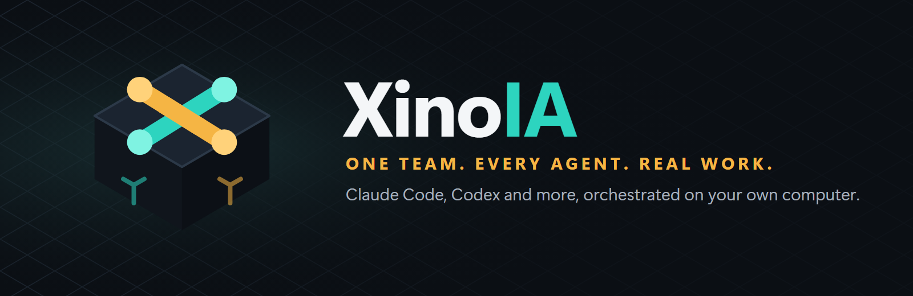

# XinoIA — Sua equipe de IA, no seu computador, em um só escritório

<p align="center">
  <a href="README.md">English</a> · <a href="README.pt-BR.md">Português (Brasil)</a>
</p>

<p align="center">
  
</p>

<p align="center">
  <a href="https://github.com/HelioASjunior/agents-ia/actions/workflows/ci.yml"></a>
  
  
  
  <a href="LICENSE"></a>
</p>

O XinoIA coloca Claude Code, Codex CLI e outros agentes de programação para trabalhar como uma equipe no seu computador. Você passa um objetivo, e cada agente assume uma tarefa e entrega o resultado para o próximo, no mesmo projeto. Você acompanha tudo em um terminal ao vivo, conversa com qualquer agente pelo chat e vê o trabalho acontecer em um escritório virtual, onde cada animação vem de um evento real.

**Suas contas, sua máquina.** O XinoIA usa o CLI oficial de cada fornecedor, com o login de assinatura que você fez nele, então não precisa de chaves de API. Ele nunca vê suas credenciais. Projetos, conversas e histórico ficam em um banco de dados local, e não existe servidor nem cadastro do XinoIA.

[Baixar](https://github.com/HelioASjunior/agents-ia/releases/latest) · [Suporte a provedores](docs/PROVIDERS.md) · [Arquitetura](docs/ARCHITECTURE.md) · [Roteiro](docs/ROADMAP.md) · [Novidades](CHANGELOG.md)

> [!IMPORTANT]
> **O XinoIA está em desenvolvimento ativo e ainda não tem instalador.** O backend e as integrações reais com os CLIs já funcionam e têm testes, mas o aplicativo desktop e a interface ainda estão sendo construídos. A tabela em [Situação do projeto](#situação-do-projeto) mostra exatamente o que existe.

## Instalação

### Instalador para Windows (em breve)

Quando a primeira versão for publicada, você vai instalar o XinoIA como qualquer outro programa:

1. Abra [Releases](https://github.com/HelioASjunior/agents-ia/releases/latest).
2. Baixe o `XinoIA-Setup-vX.X.X.exe`.
3. Execute o instalador e abra o **XinoIA** pelo menu Iniciar.

Você não vai precisar de Node.js nem de ferramentas de desenvolvimento. O XinoIA vai detectar suas ferramentas de IA e orientar a instalação e o login delas.

### Pelo código-fonte (já disponível)

Isto executa o backend e é voltado a desenvolvedores. Você precisa do [Node.js 24+](https://nodejs.org) e do [Git](https://git-scm.com).

```bash
git clone https://github.com/HelioASjunior/agents-ia.git
cd agents-ia
npm install
npm run doctor
```

O `npm run doctor` mostra quais ferramentas de IA o XinoIA encontrou no seu computador. Para iniciar o servidor local:

```bash
npm run dev:server
```

## Configure suas ferramentas de IA

Instale as ferramentas que quiser e entre com a sua própria conta. O XinoIA não as inclui.

```bash
npm install -g @anthropic-ai/claude-code
claude auth login
```

```bash
npm install -g @openai/codex
codex login
```

## Como as partes se encaixam

- **Provedores** são adaptadores em volta de cada CLI oficial. Nada mais no XinoIA conhece as opções de um fornecedor, então adicionar uma ferramenta não afeta o resto.
- **Perfis** mantêm cada conta em uma pasta própria, usando o isolamento que o próprio CLI oferece.
- **Agentes** combinam um papel, uma ferramenta, um perfil, um nível de permissão e integrações opcionais.
- **Execuções** rodam um processo de verdade. A saída dele vira eventos, salvos localmente e transmitidos ao vivo.
- **O banco de dados** é SQLite em modo WAL, com migrações versionadas e cópias de segurança automáticas. Não é preciso um servidor de banco de dados.

## Ferramentas suportadas

| Ferramenta | Assinatura, sem chave de API | Vários perfis | Situação |
| --- | --- | --- | --- |
| Claude Code | Sim | Sim | Testado com conta real |
| Codex CLI | Sim | Sim | Testado com conta real |
| Gemini CLI | Login Google | Sim | Escrito pela documentação, **ainda não testado** |
| Agentes locais personalizados | Depende da ferramenta | Depende da ferramenta | Testado com CLI local de teste |

Assinatura não é acesso ilimitado por API: os limites do seu plano continuam valendo. O XinoIA mostra o uso apenas quando o CLI informa, e nunca troca de conta sozinho para contornar um limite. Veja [Suporte a provedores](docs/PROVIDERS.md) para mais detalhes e um resumo dos termos dos fornecedores.

## Unreal Engine

Ative a integração Unreal Engine em qualquer agente para usar as skills oficiais da Epic Games e as ferramentas do Unreal Editor por MCP. O Claude Code carrega o plugin mesmo em um perfil isolado, e o Codex CLI recebe o servidor MCP e os caminhos das skills.

Agentes no mesmo editor trabalham um de cada vez, porque a própria skill alerta sobre conflitos. O carregamento do plugin e a configuração têm testes. As chamadas de ferramenta com o editor aberto ainda não foram testadas. Veja [configuração e limites](docs/PROVIDERS.md#unreal-engine-epic-games).

## Segurança

- O servidor escuta apenas em `127.0.0.1` e exige um token gerado a cada inicialização.
- As verificações de `Host` e `Origin` bloqueiam pedidos vindos de páginas web e DNS rebinding.
- Os prompts passam por stdin e nunca viram argumentos de linha de comando.
- Segredos impressos por um agente são mascarados antes de serem salvos ou exibidos.
- Chaves de API são removidas do ambiente dos CLIs conhecidos, para evitar cobrança por API sem querer.

Agentes podem ler e alterar arquivos na pasta do projeto e, nos níveis mais altos de permissão, executar comandos. Escolha o nível de cada agente com cuidado e use Git.

## Situação do projeto

| Fase | Escopo | Situação |
| --- | --- | --- |
| 1 | Backend, banco de dados, integração real com CLIs | **Concluída e testada** |
| 2 | Orquestrador, tarefas, revisão entre agentes | **Concluída e testada** |
| 3 | Chat, terminal, monitoramento | **Concluída e testada** |
| 4 | Projetos, workflows, Git worktrees | **Concluída e testada** |
| 5 | Escritório virtual e identidade visual | **Concluída e testada** |
| 6 | Instalador, atualizações automáticas, releases | Planejada |

## Desenvolvimento

```bash
npm install
npm run typecheck
npm test
```

O `npm run test:real` roda com os CLIs reais e as contas logadas, e gasta um pouco da cota do seu plano. Por isso fica fora do CI.

As regras do repositório estão em [CLAUDE.md](CLAUDE.md).

## Licença

[Apache License 2.0](LICENSE). A licença não concede direitos sobre o nome e o logotipo do XinoIA; veja o [NOTICE](NOTICE).

O XinoIA é um projeto independente, sem vínculo com Anthropic, OpenAI, Google ou Epic Games, e sem o endosso delas. Claude, Codex, Gemini e Unreal Engine são marcas de seus respectivos donos.
